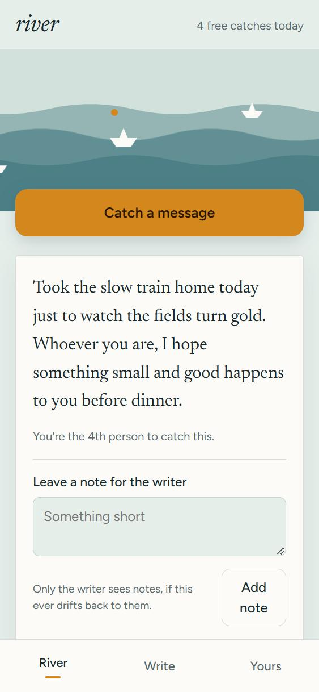
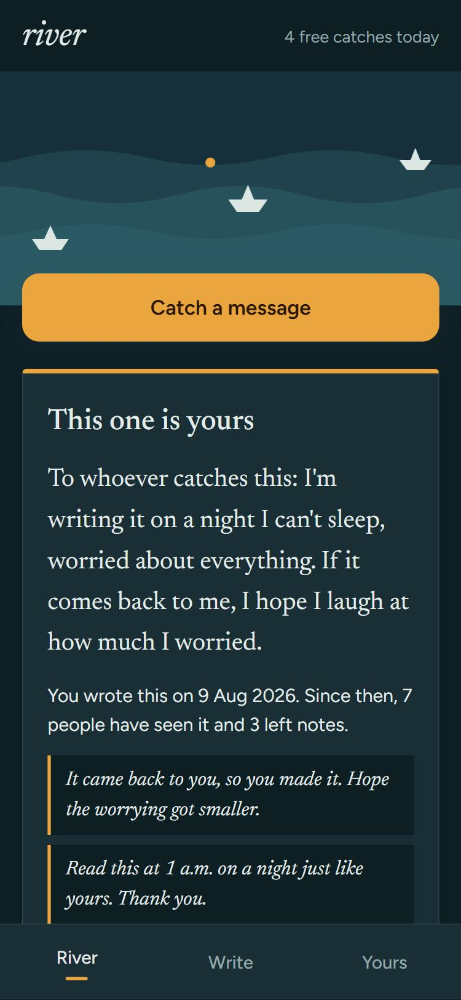
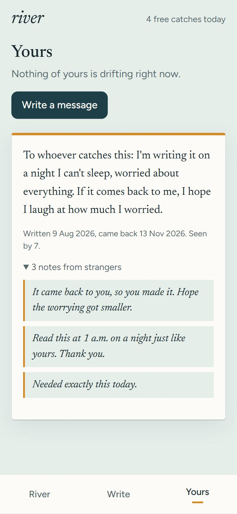

# River

**Drop an anonymous message into a shared river. Catch one from a stranger. One day, without
warning, yours comes back, and you see how many people read it and what they left you.**

<p align="center">
  
  &nbsp;
  
  &nbsp;
  
</p>
<p align="center"><sub>Catching a stranger's message · your own message coming back · the Yours tab (local dev build, demo data)</sub></p>

## The idea

People write short anonymous messages (20–500 characters) and let them drift. Others catch them
one at a time, at most once each, and can attach a private note that only the author will ever
see. Every message carries a hidden return date, picked at random inside a window the author
chooses ("within a few months" to "years from now"). On that day the author catches their own
message back: *"You wrote this on 9 Aug 2026. Since then, 7 people have seen it and 3 left notes."*

The surprise only works if the author forgets, so the app never shows or sends that date, not even
to the author's own device.

## What works today

- **The full loop:** write → catch → note → return → keep, with daily limits (3 writes, 5 free
  catches) that refill at local midnight in each user's own time zone.
- **Real sign-in** with Supabase Auth (Google and email magic link), plus a short first-run explainer.
- **Moderation basics:** a shared wordlist and phone/email filter on both client and server,
  one-tap reports, and auto-hide after 3 unique reports.
- **"From the river" messages:** curated seed messages that only appear once you've read every real
  message, so the river never runs dry but never crowds out people either.
- **Mobile-first web app** (PWA manifest; offline support comes with launch) with light and dark
  themes and `prefers-reduced-motion` support, ported from a hand-built HTML prototype ([`river-prototype.html`](river-prototype.html)).

## How it works

A few decisions that shape the code:

- **Secrets stay on the server.** All river rules live in one module
  ([`backend/app/river.py`](backend/app/river.py)). API responses are explicit Pydantic models
  ([`schemas.py`](backend/app/schemas.py)) that leave out `return_at` and `author_id`, and a test calls
  each endpoint and fails if either ever appears in a response.
- **Each catch is one transaction.** It locks the user's row, serves a due return first (free,
  even with 0 catches left), then picks a random unseen message and spends a catch. Two
  simultaneous catches can't both spend the last one, and a test proves it with real threads.
- **"Never the same message twice" is a database guarantee.** `catches` has primary key
  `(user_id, message_id)`. A [Hypothesis](https://hypothesis.readthedocs.io/) property test drives
  random sequences of writes and catches across many users and checks the rule holds.
- **Random picks without `ORDER BY random()`.** Each message stores an indexed random key; a catch
  seeks from a random point and wraps around, so picking stays cheap as the table grows.
- **Supabase only for auth.** The FastAPI backend verifies Supabase access tokens itself: signature
  via the project's JWKS (ES256/RS256, or the legacy HS256 secret), expiry, audience and issuer.
  All data lives in the app's own Postgres, behind the API.
- **Time is a single dependency.** Everything reads "now" from [`clock.py`](backend/app/clock.py),
  including timestamps the database would otherwise default. In dev mode a panel can move the
  server clock forward a day, month or year, which makes months-long return windows testable in
  seconds. Production builds strip the panel, and the server refuses the dev routes outside dev mode.
- **Configuration with guard rails.** Return windows, limits and the 30-day cooling period are env
  vars, validated at startup. No message returns before the cooling period, even if a window is
  misconfigured below it.

## Stack

| | |
|---|---|
| Frontend | React 19, TypeScript, Vite, supabase-js; plain CSS with design tokens |
| Backend | Python, FastAPI, SQLAlchemy 2, Alembic, PyJWT, Pydantic Settings |
| Data and auth | PostgreSQL 16, Supabase Auth |
| Tests | pytest, Hypothesis, FastAPI TestClient against a real Postgres |

## Run it locally

You need Python 3.11+, Node 20.19+ (or 22.12+) and Postgres 16 on `localhost:54329` with role `river` / password
`river` and databases `river` and `river_test` (dev-only credentials). Either:

- **Docker:** `docker compose up -d db` creates both databases on first start.
- **Native:** install Postgres 16 on port 54329, then as `postgres`:
  `create role river login password 'river'; create database river owner river; create database river_test owner river;`

Copy `backend/.env.example` to `backend/.env` and `frontend/.env.example` to `frontend/.env.local`
(both gitignored). Fill in a Supabase project URL and anon key to use real sign-in. Without them the
app runs with a fake dev user, so Supabase is optional for trying it out.

```bash
cd backend && python -m venv .venv && .venv/Scripts/pip install -r requirements-dev.txt
```

```bash
cd backend && .venv/Scripts/alembic upgrade head && .venv/Scripts/python -m app.seed
```

```bash
cd backend && .venv/Scripts/uvicorn app.main:app --reload --port 8000
```

```bash
cd frontend && npm install && npm run dev
```

Open http://localhost:5173. (On macOS or Linux, use `.venv/bin/` instead of `.venv/Scripts/`.)
In dev builds, the **Dev** pill in the header switches the fake user, moves the server clock,
makes your messages due now, and refills catches.

## Tests

```bash
cd backend && .venv/Scripts/python -m pytest -q
```

62 tests run against a real Postgres (`river_test`, schema rebuilt each run). They cover the product
rules (no repeats, no early returns, a reveal never costs a catch), concurrency, the
no-leak check, JWT verification (valid, expired, wrong audience or issuer, forged and unsigned
tokens), time-zone refills, the dev clock and the content filter.

## Seed messages

Seeds live in [`backend/app/seeds.txt`](backend/app/seeds.txt), one paragraph each.
`python -m app.seed` loads new ones; it's idempotent and rejects the whole file if any seed fails
the length or content checks. `python -m app.generate_seeds` can draft candidates with Claude Haiku
into a gitignored review file. Nothing generated reaches the river until a person approves it.

## Roadmap

Built in phases (full spec in [`HANDOFF.md`](HANDOFF.md)):

- [x] **Phase 1, core loop:** schema, write/catch/note/return, PWA screens
- [x] **Phase 2, real auth and timing:** Supabase Auth, per-user time zones, cooling period, dev clock
- [x] **Seed messages** "from the river"
- [ ] **Phase 3, moderation:** note reports, penalties for authors of hidden messages, admin page
- [ ] **Phase 4, payments:** extra catches via Razorpay with webhook verification; ads only on the
  "out of catches" and "river is calm" screens
- [ ] **Phase 5, launch:** offline/installable PWA, account deletion and export, backups, privacy
  policy, Capacitor builds

## Project layout

```
backend/
  app/
    river.py         all river rules: writing, catching, notes, returns
    auth.py          Supabase JWT verification (+ dev-only fake users)
    clock.py         single source of "now", with the dev offset
    schemas.py       everything that may leave the server
    seed.py          seed loader; seeds.txt holds the reviewed messages
  alembic/           migrations
  tests/
frontend/src/
  RiverView.tsx      catch, note, reveal
  WriteView.tsx      write and choose a return window
  YoursView.tsx      returned messages and notes
  AuthView.tsx       sign-in and first-run explainer
  api.ts, auth.ts    API client (Bearer token) and Supabase session
```
